<p align="center">
  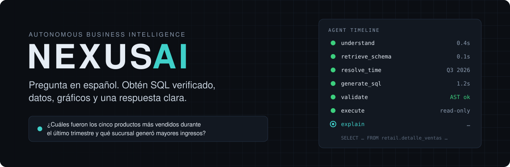
</p>

<p align="center">
  <a href="https://github.com/ErickEchea/Agente-aut-nomo-Text-to-SQL/actions/workflows/ci.yml"></a>
  
  
  
  
  
  <a href="LICENSE"></a>
</p>

<p align="center">
  <a href="README.md">Español</a> · <b>English</b>
</p>

---

**NEXUS AI** is an autonomous *Text-to-SQL* agent. You ask a business question in Spanish
(*"¿qué sucursal vendió más el último trimestre?"*) and the agent:

1. understands the question and finds the right tables;
2. writes the SQL and **validates it before running it**;
3. runs it in **read-only** mode;
4. returns the table, a chart and an executive summary whose numbers are checked against the actual results.

Everything runs **on your machine**. Models are served by [Ollama](https://ollama.com): no paid APIs, and your
data never leaves your network.

<p align="center">
  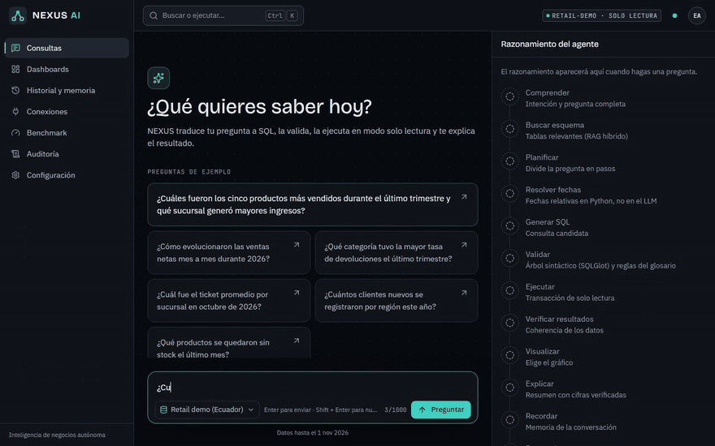
  <br><sub>A real run with the local model (<code>make demo-gif</code>): the reference question, then the follow-up "¿Y en el trimestre anterior?" (and the previous quarter?). Only the waits for the model are sped up.</sub>
</p>

> [!NOTE]
> **Project status.** **All seven phases are complete** ([roadmap](#-roadmap)): the web app lets you ask PostgreSQL, MySQL or SQLite, watch the agent reason live, explore the result as a table,
> chart and clause-by-clause annotated SQL, analyze the query plan with suggested indexes, pin it to dashboards,
> and review history, connections and the audit log. A 126-question benchmark measures the agent and chose
> the default model from data, and a final security review hardened the containers, dependencies and CI
> ([review](docs/security-review.md)).

## ✨ What it does

Reference question:

> *¿Cuáles fueron los cinco productos más vendidos durante el último trimestre y qué sucursal generó mayores
> ingresos?* (Which five products sold the most last quarter, and which branch generated the most revenue?)

**The agent already answers it correctly end to end** (3/3 consecutive live runs, `make e2e-agent`). The top five products by units sold in Q3 2026 are:

1. Agua mineral 1.5 L (4,768 units)
2. Pollo entero Mr. Pollo (2,707 units)
3. Leche Toni (2,555 units)
4. Leche Parmalat (2,098 units)
5. Aceite La Favorita (1,834 units)

The top branch by revenue is **Samborondón, with USD 299,672.19**. This is net revenue: IVA (VAT), voided sales
and returned lines are excluded, as defined in the [business glossary](data/glossary.yaml).

| | Capability | Status |
|---|---|---|
| 🧠 | Intent detection; asks for clarification with concrete options instead of guessing | ✅ |
| 📅 | Relative dates ("last quarter") resolved in Python, not by the LLM, and shown as visible assumptions | ✅ |
| 🛡️ | SQL validated on the syntax tree (SQLGlot) and executed through a read-only database role | ✅ |
| 🔁 | Self-repair from database errors and glossary violations (max. 3 attempts) | ✅ with a red/green diff in the timeline |
| 🔎 | Hybrid schema RAG (pgvector + Spanish full-text + trigrams). Every needed table was in context for 32/32 eval questions | ✅ |
| 👁️ | Live reasoning: an animated timeline of every agent step (status, timing, tokens, highlighted SQL, expandable output) | ✅ |
| 📊 | Result tabs: Table (virtualized, filter, CSV) · Chart (ECharts, PNG) · SQL · Explanation, KPI cards and **dashboards** | ✅ |
| ⌨️ | Command palette (Ctrl/⌘ K), dark and light modes, Spanish and English, accessible (WCAG 2.2 AA), usable from 375 px | ✅ |
| ✅ | Summaries never contain invented numbers: every figure is checked against the results | ✅ |
| 🧩 | Memory: follow-ups ("and the previous quarter?"), frequent questions, preferences, verified examples | ✅ |
| 📖 | Clause-by-clause annotated SQL: every part of the query explained from the schema comments and the glossary rules it satisfies, with no LLM, highlighted in the code | ✅ |
| ⚡ | Optimization: reads `EXPLAIN` without running the query, flags full scans and suggests indexes with cost before/after measured with hypothetical indexes (HypoPG). NEXUS never creates the index | ✅ |
| 🔌 | Multiple databases (PostgreSQL, MySQL, SQLite) with credentials encrypted at rest (Fernet, key rotation), a connection test that detects write privileges, and schema indexing | ✅ |
| 📈 | Benchmark of 126 questions with known answers: execution accuracy per local model, and the default model chosen by a rule fixed in advance ([results](docs/benchmark.md)) | ✅ 71.4 % with `qwen2.5-coder:7b` |

## 🧭 How it works


The agent is a [LangGraph](https://langchain-ai.github.io/langgraph/) state graph, with one small and testable
node per responsibility. Node contracts, state and the streaming protocol are documented in
[`docs/ARCHITECTURE.md`](docs/ARCHITECTURE.md).

## 🛡️ Security: defense in depth

LLM-written SQL passes several layers before it runs. **Each layer must block destructive SQL on its own**
([ADR-0005](docs/adr/0005-sql-safety-defense-in-depth.md)):
1. Pydantic schema on the model's output.
2. AST validation with SQLGlot.
3. A SELECT-only database role.
4. A `READ ONLY` transaction with statement timeouts.
5. A separate connection pool, with every query audited.

**Attack suite ✅.** 62 SQL attacks run in three modes: validator only, database only (validator off), and
the validator guarding a role that *could* write. All are blocked and the data is unchanged. Ten
natural-language attacks are refused before the model is called.

Integration tests against a real PostgreSQL also prove that the agent role (`nexus_reader`):
- cannot run `INSERT`, `UPDATE`, `DELETE`, `TRUNCATE`, `DROP`, `ALTER`, `CREATE` or `COPY … TO PROGRAM`;
- still cannot write after turning off `default_transaction_read_only` in its own session;
- cannot call `pg_sleep`, `set_config`, `pg_terminate_backend`, `pg_read_file` or `lo_import`;
- cannot connect to other databases on the server.

The readiness endpoint also turns red if the API is ever configured with a role that can write.

**Hardened infrastructure ✅**
- **One way in.** nginx is the only ingress; the API publishes no port.
- **Containers.** They run with no Linux capabilities and cannot gain privileges; stateless ones also
  have a read-only root filesystem.
- **Connections.** A registered data source cannot point at NEXUS's own database, at Ollama, or at cloud
  metadata addresses.
- **CI.** pip-audit, npm audit, gitleaks and Trivy audit the dependencies, the git history and the
  images with pinned versions, and the GitHub Actions are pinned by commit SHA.

Findings and accepted risks are in the [security review](docs/security-review.md); the reporting
policy is in [`SECURITY.md`](SECURITY.md).

## 🇪🇨 Demo data: an Ecuadorian retail chain

The demo database covers **two years of a fictional retail chain**, in USD, from Nov 2024 to Oct 2026. Its main
tables:

| Table | Rows |
|---|---:|
| `detalle_ventas` (sale lines) | 499,485 |
| `inventario` (inventory snapshots) | 228,679 |
| `ventas` (sales) | 196,091 |
| `clientes` (customers) | 25,000 |

The data has local realism:
- 24 branches in 16 provinces, with brands sold in Ecuador.
- Valid national ID numbers (cédulas) and 15 % VAT.
- An Ecuadorian commercial calendar: Carnaval, the 13th- and 14th-month salary bonuses by region, the coastal
  vs. highland school calendars, Black Friday and the 2026 World Cup.

It also contains **planted anomalies for the agent to discover**: a stock-out, a returns spike, a temporary
closure, a new branch, an outlier order and a deliberately missing index.

The generator is deterministic: the same seed produces byte-identical data on Windows and Linux. Every table and
column carries a Spanish `COMMENT ON`, which feeds the schema RAG. Full design:
[ADR-0017](docs/adr/0017-retail-demo-dataset.md).

## 🚀 Quick start

**Requirements:** Docker (Compose v2), `make`, `openssl` and ~16 GB of free disk (~13 GB on CPU). NVIDIA GPUs are detected
automatically; without one, a smaller model runs on the CPU.

```bash
git clone https://github.com/ErickEchea/Agente-aut-nomo-Text-to-SQL.git
cd Agente-aut-nomo-Text-to-SQL
make up
```

`make up` does everything in one step:
1. generates `.env` with random secrets;
2. detects the GPU and builds the images;
3. loads the demo data and pulls the models;
4. waits until every service is healthy.

**Measured on a fresh clone:**
- **Build and start:** about 2 minutes on the reference machine.
- **First-time download:** ≈9 GB with a GPU or ≈6.5 GB on CPU (the Ollama image and the models).
- **Total:** **about 10 minutes** on a 150 Mbps connection.

Once it finishes:

- Web app: http://localhost:8080 (sign in with `NEXUS_ADMIN_EMAIL` / `NEXUS_ADMIN_PASSWORD` from `.env`)
- Readiness check: http://localhost:8080/api/health/ready
- Interactive API docs (with `NEXUS_ENV=development` in `.env`): http://localhost:8080/api/docs

<p align="center">
  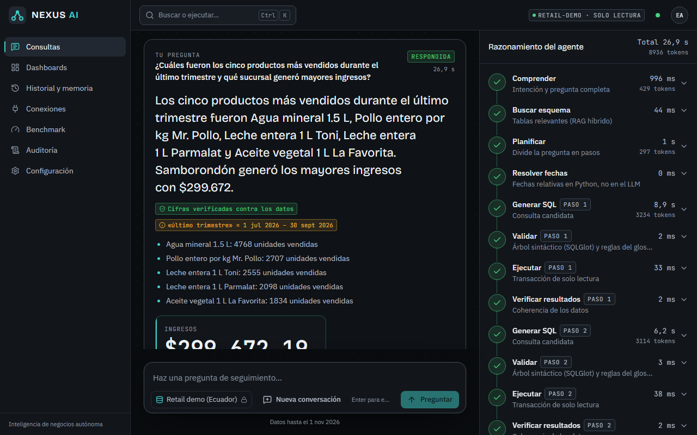
  <br><sub>The reference question answered: summary with verified figures, a visible date assumption, and the agent timeline with every step, its duration and tokens.</sub>
</p>

<table>
  <tr>
    <td width="50%">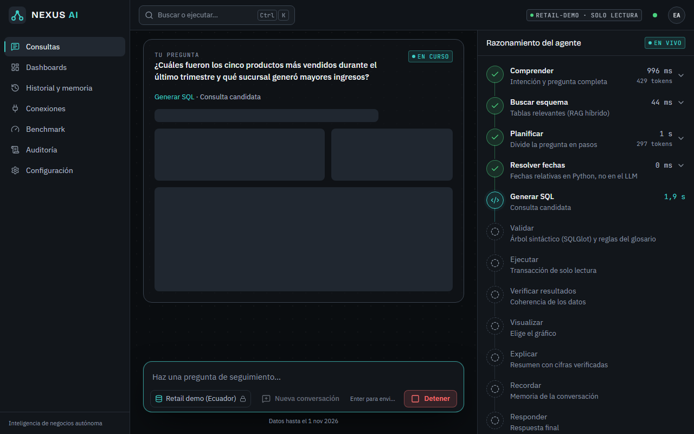</td>
    <td width="50%">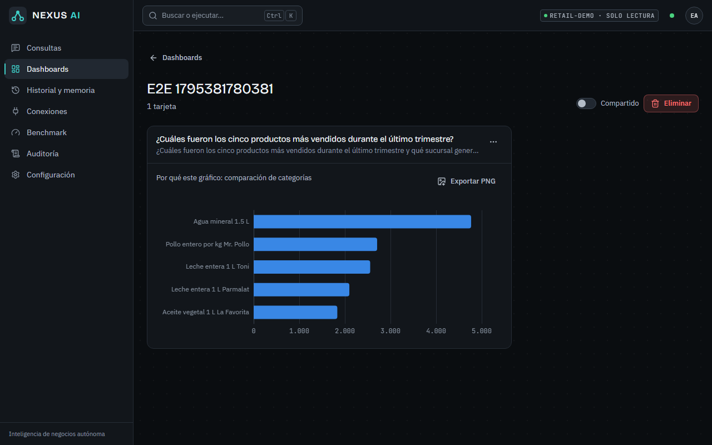</td>
  </tr>
  <tr>
    <td><sub><b>Live:</b> each graph node appears as it starts, with a running timer; pending steps are dimmed.</sub></td>
    <td><sub><b>Dashboards:</b> pin any result and come back to it without querying again.</sub></td>
  </tr>
  <tr>
    <td>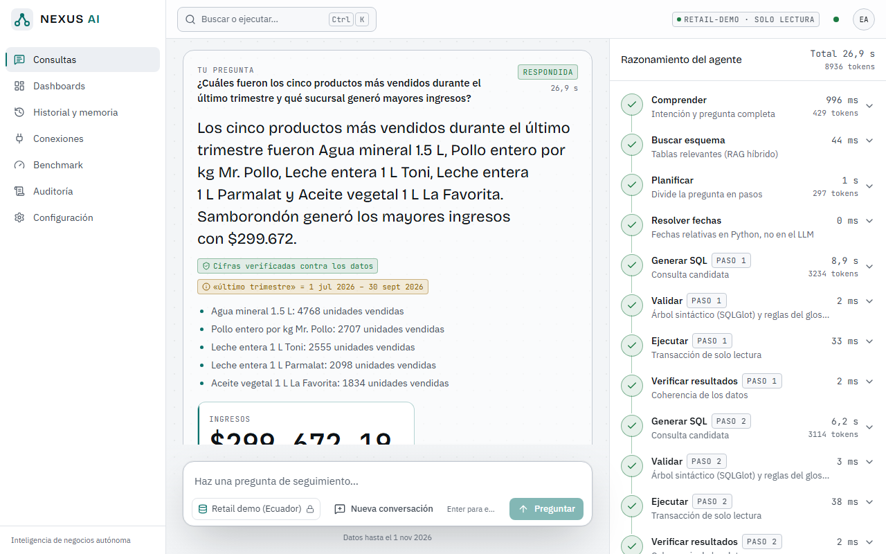</td>
    <td>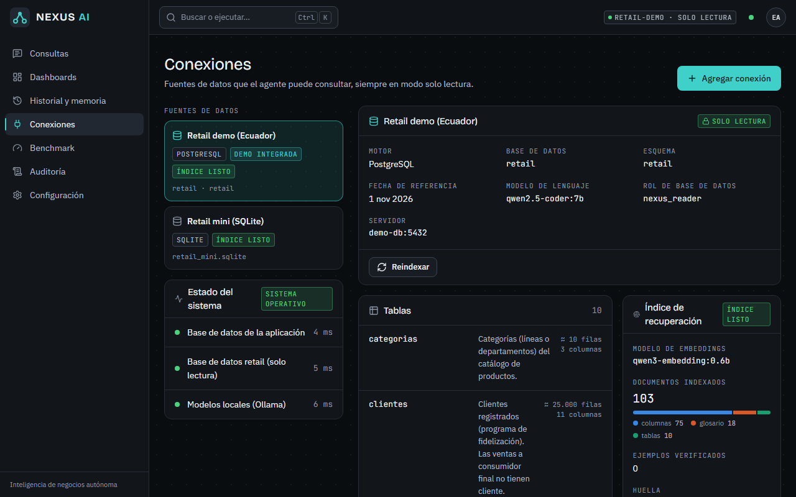</td>
  </tr>
  <tr>
    <td><sub>Light mode (designed, not inverted), with AA contrast checked by tests.</sub></td>
    <td><sub><b>Connections:</b> tables with their comments, row estimates and the RAG index state.</sub></td>
  </tr>
  <tr>
    <td>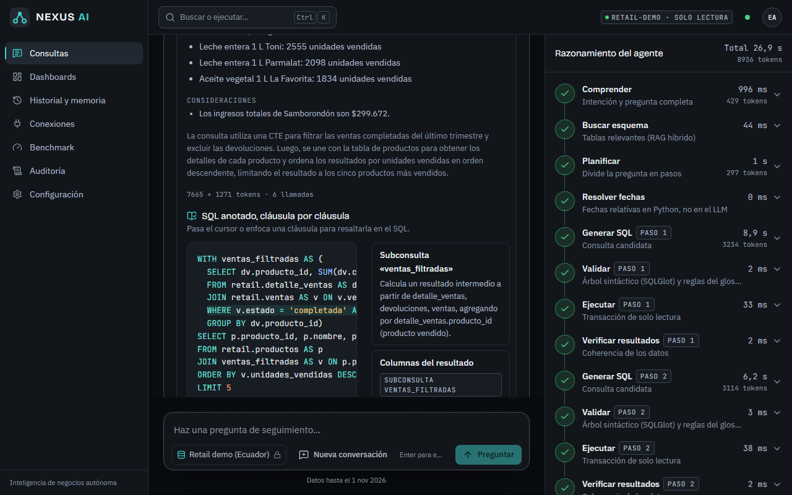</td>
    <td>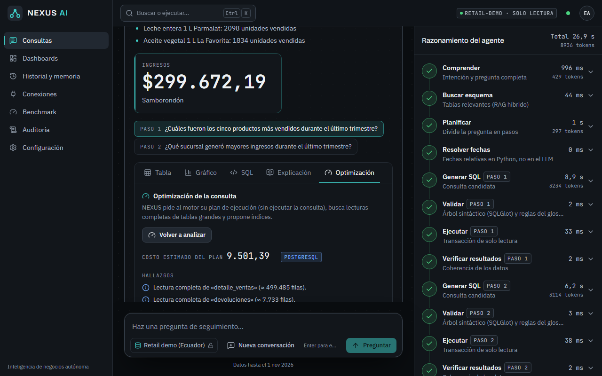</td>
  </tr>
  <tr>
    <td><sub><b>Annotated SQL:</b> each clause explained from the schema comments and glossary rules; hovering highlights it in the SQL.</sub></td>
    <td><sub><b>Optimization:</b> full scans found in the plan and suggested indexes, measured with hypothetical indexes (HypoPG).</sub></td>
  </tr>
  <tr>
    <td>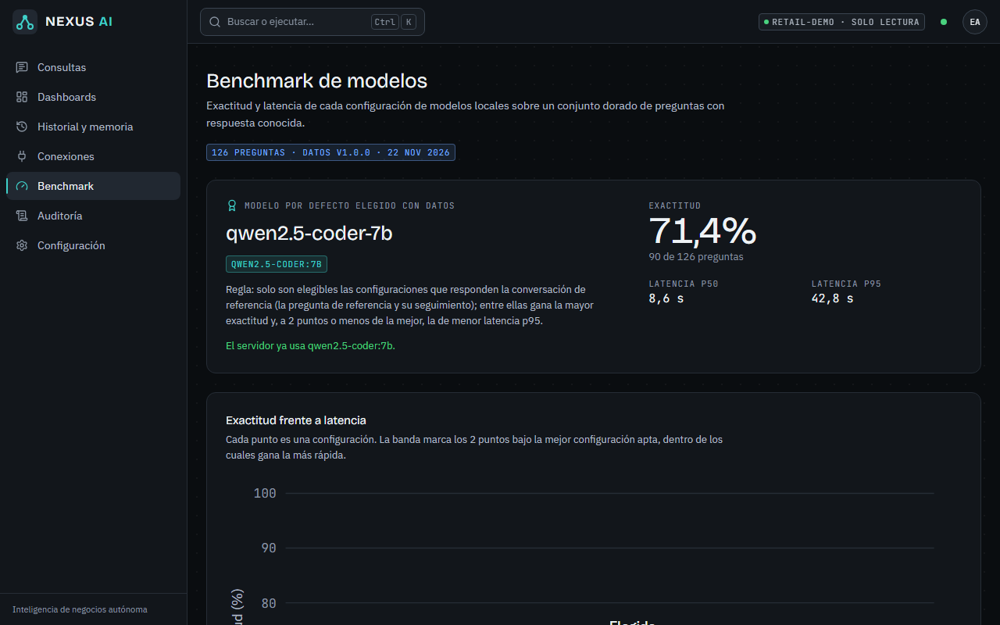</td>
    <td>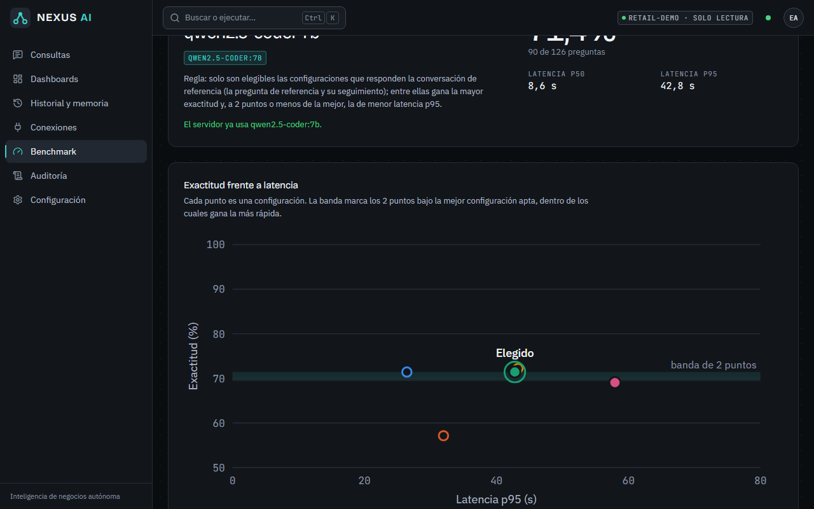</td>
  </tr>
  <tr>
    <td><sub><b>Benchmark:</b> 126 questions with known answers choose the default model with a rule fixed in advance.</sub></td>
    <td><sub><b>Accuracy vs latency:</b> hollow points fail the reference conversation and cannot be the default.</sub></td>
  </tr>
</table>

All screenshots (every screen in dark/light × desktop/375 px) are in
[`docs/screenshots/phase6`](docs/screenshots/phase6), regenerated by `make e2e`.

On Windows, run the commands from Git Bash after `winget install ezwinports.make`.

## 🏗️ Stack

| Layer | Technology |
|---|---|
| Frontend | React 19, TypeScript (strict), Vite 8, Tailwind v4 on design tokens, Radix primitives styled the shadcn/ui way, Motion, TanStack Query/Table/Virtual, ECharts 6, Shiki, cmdk, i18next (es/en) |
| Backend | Python 3.13, FastAPI, Pydantic v2, SQLAlchemy 2 (async), structlog |
| Agent | LangGraph, SQLGlot, swappable `LLMProvider` |
| Models | Ollama. Default `qwen2.5-coder:7b`, chosen by the benchmark over `qwen3:8b`, `gemma4:e4b-it-qat` and a per-node routing ([ADR-0022](docs/adr/0022-default-model-from-benchmark.md)). Embeddings: `qwen3-embedding:0.6b` |
| Data | PostgreSQL 18 (pgvector, HypoPG), MySQL 8, SQLite |
| Infrastructure | Docker Compose (unprivileged containers), Makefile, GitHub Actions, Dependabot |
| Quality | pytest, Testcontainers, Hypothesis, Vitest, Playwright, k6, ruff, mypy `--strict`, ESLint |

## 🗺️ Roadmap

| Phase | Scope | Status |
|---|---|---|
| 0 | Plan, architecture and ADRs | ✅ |
| 1 | Docker Compose, demo database, read-only role, observability, CI | ✅ |
| 2 | Agent core: generation, AST validation, execution, repair, SSE, auth, 62+ attack suite | ✅ |
| 3 | Schema RAG, verified examples, memory, charts, grounded explanations | ✅ |
| 4 | Full UI: design system, live agent timeline, dashboards, command palette | ✅ |
| 5 | Clause-level explainability, `EXPLAIN`-based optimization, multi-database support | ✅ |
| 6 | Benchmark of 126 questions; default model selection | ✅ |
| 7 | Security review, hardening, dependency audit, load check, final docs, demo GIF | ✅ |

## 🧪 Quality

**Backend.** 648 tests (unit, security and integration against real PostgreSQL, MySQL and SQLite). Coverage is 95 % on
`agent/`, `security/` and `sql/`, gated at 85 % in CI. ruff and `mypy --strict` are clean.

**Agent.** 71.4 % execution accuracy on 126 golden questions (easy 95 %, medium 65 %, hard 39 %, ambiguous
93 %; [benchmark](docs/benchmark.md)). A live end-to-end test runs the reference question and its follow-up
against the real model (`make e2e-agent`). [Retrieval evaluation](docs/retrieval-eval.md): every needed table was in context for
32/32 questions.

**Frontend.** 110 Vitest tests (token AA contrast, SSE parser, timeline, charts, CSV, i18n parity, benchmark scales).
26 Playwright tests visit every screen in dark/light × desktop/375 px with axe (WCAG 2.2 AA), register and delete a
SQLite source, check the Benchmark page with real results, and the reference question
also runs in the browser against the real model. Strict ESLint and `tsc`.

**CI.** Every push runs the above in GitHub Actions, audits the dependencies, the git history and the images
(pip-audit, npm audit, gitleaks, Trivy) and builds the Docker images. Every code change also brings up the
full stack on CPU to run Playwright and the benchmark's CI subset against a calibrated accuracy gate.

**Security and load.**
- **Audit results.** No known vulnerabilities in the dependencies, no secrets in the git history, and
  no fixable HIGH/CRITICAL CVEs in the images this repository builds
  ([security review](docs/security-review.md)).
- **Load.** Browsing at 20 requests/s while 4 users ask at once stays at 8 ms p95 with no errors, and
  all 8 questions are answered ([load test](docs/load-test.md)).

Useful targets: `make audit` (the security audit), `make load` (the load check) and `make demo-gif`
(re-records the demo with the real model).

## 📚 Documentation

[Architecture](docs/ARCHITECTURE.md) · [Design system](docs/DESIGN.md) · [ADRs](docs/adr/README.md) (23) ·
[Benchmark](docs/benchmark.md) · [Security review](docs/security-review.md) · [Security policy](SECURITY.md) ·
[Load test](docs/load-test.md) · [Roadmap](docs/ROADMAP.md) · [Progress log](PROGRESS.md) ·
[Contributor conventions](CLAUDE.md)

<p align="center"><sub><a href="LICENSE">MIT</a> licensed · Made in Ecuador 🇪🇨 · Demo data is synthetic; any resemblance to real people is coincidental.</sub></p>
