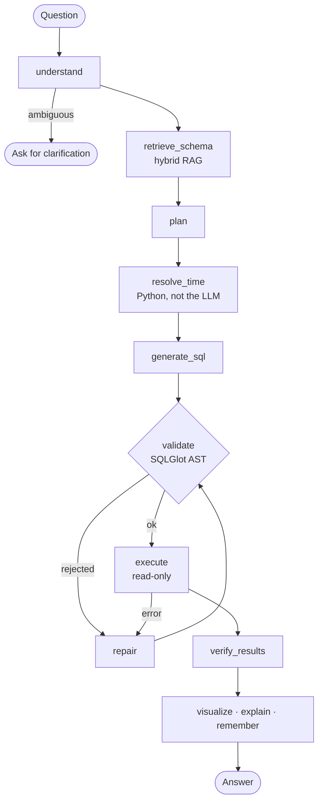

<p align="center">
  
</p>

<p align="center">
  <a href="https://github.com/ErickEchea/Agente-aut-nomo-Text-to-SQL/actions/workflows/ci.yml"></a>
  
  
  
  
  
  <a href="LICENSE"></a>
</p>

<p align="center">
  <a href="README.md">Español</a> · <b>English</b>
</p>

---

**NEXUS AI** is an autonomous *Text-to-SQL* agent. You ask a business question in Spanish
(*"¿qué sucursal vendió más el último trimestre?"*) and the agent:

1. understands the question and finds the right tables;
2. writes the SQL and **validates it before running it**;
3. runs it in **read-only** mode;
4. returns the table, a chart and an executive summary whose numbers are checked against the actual results.

Everything runs **on your machine**. Models are served by [Ollama](https://ollama.com): no paid APIs, and your
data never leaves your network.

> [!NOTE]
> **Project status.** NEXUS AI is built in phases ([roadmap](#-roadmap)). **Phases 1–3 are complete**:
> the agent answers end to end through the API while streaming every step. It retrieves only the relevant
> tables, remembers the conversation, proposes charts and writes a summary whose numbers are checked
> against the data. The full web UI comes in Phase 4. This page
> always separates what **works today** ✅ from what is **planned** 🗓️.

## ✨ What it does

Reference question:

> *¿Cuáles fueron los cinco productos más vendidos durante el último trimestre y qué sucursal generó mayores
> ingresos?* (Which five products sold the most last quarter, and which branch generated the most revenue?)

**The agent already answers it correctly end to end** (3/3 consecutive live runs, `make e2e-agent`). The top five products by units sold in Q3 2026 are:

1. Agua mineral 1.5 L (4,768 units)
2. Pollo entero Mr. Pollo (2,707 units)
3. Leche Toni (2,555 units)
4. Leche Parmalat (2,098 units)
5. Aceite La Favorita (1,834 units)

The top branch by revenue is **Samborondón, with USD 299,672.19**. This is net revenue: IVA (VAT), voided sales
and returned lines are excluded, as defined in the [business glossary](data/glossary.yaml).

| | Capability | Status |
|---|---|---|
| 🧠 | Intent detection; asks for clarification with concrete options instead of guessing | ✅ |
| 📅 | Relative dates ("last quarter") resolved in Python, not by the LLM, and shown as visible assumptions | ✅ |
| 🛡️ | SQL validated on the syntax tree (SQLGlot) and executed through a read-only database role | ✅ |
| 🔁 | Self-repair from database errors and glossary violations (max. 3 attempts) | ✅ · visual diff Phase 4 |
| 🔎 | Hybrid schema RAG (pgvector + Spanish full-text + trigrams). Every needed table was in context for 32/32 eval questions | ✅ |
| 👁️ | Live reasoning: every agent step is streamed over SSE (timings, tokens, SQL, results) | ✅ API · 🗓️ timeline Phase 4 |
| 📊 | Tabs for table, chart (ECharts), SQL, explanation and optimization, plus pinned dashboards | 🗓️ Phases 4–5 |
| ✅ | Summaries never contain invented numbers: every figure is checked against the results | ✅ |
| 🧩 | Memory: follow-ups ("and the previous quarter?"), frequent questions, preferences, verified examples | ✅ |
| 🔌 | Multiple databases (PostgreSQL, MySQL, SQLite) with credentials encrypted at rest | 🗓️ Phase 5 |
| 📈 | Accuracy benchmark of 120+ questions that picks the default model from data | 🗓️ Phase 6 |

## 🧭 How it works



The agent is a [LangGraph](https://langchain-ai.github.io/langgraph/) state graph, with one small and testable
node per responsibility. Node contracts, state and the streaming protocol are documented in
[`docs/ARCHITECTURE.md`](docs/ARCHITECTURE.md).

## 🛡️ Security: defense in depth

LLM-written SQL passes several layers before it runs. **Each layer must block destructive SQL on its own**
([ADR-0005](docs/adr/0005-sql-safety-defense-in-depth.md)):
1. Pydantic schema on the model's output.
2. AST validation with SQLGlot.
3. A SELECT-only database role.
4. A `READ ONLY` transaction with statement timeouts.
5. A separate connection pool, with every query audited.

**Attack suite ✅.** 62 SQL attacks run in three modes: validator only, database only (validator off), and
the validator guarding a role that *could* write. All are blocked and the data is unchanged. Ten
natural-language attacks are refused before the model is called.

Integration tests against a real PostgreSQL also prove that the agent role (`nexus_reader`):
- cannot run `INSERT`, `UPDATE`, `DELETE`, `TRUNCATE`, `DROP`, `ALTER`, `CREATE` or `COPY … TO PROGRAM`;
- still cannot write after turning off `default_transaction_read_only` in its own session;
- cannot call `pg_sleep`, `set_config`, `pg_terminate_backend`, `pg_read_file` or `lo_import`;
- cannot connect to other databases on the server.

The readiness endpoint also turns red if the API is ever configured with a role that can write.

## 🇪🇨 Demo data: an Ecuadorian retail chain

The demo database covers **two years of a fictional retail chain**, in USD, from Nov 2024 to Oct 2026. Its main
tables:

| Table | Rows |
|---|---:|
| `detalle_ventas` (sale lines) | 499,485 |
| `inventario` (inventory snapshots) | 228,679 |
| `ventas` (sales) | 196,091 |
| `clientes` (customers) | 25,000 |

The data has local realism:
- 24 branches in 16 provinces, with brands sold in Ecuador.
- Valid national ID numbers (cédulas) and 15 % VAT.
- An Ecuadorian commercial calendar: Carnaval, the 13th- and 14th-month salary bonuses by region, the coastal
  vs. highland school calendars, Black Friday and the 2026 World Cup.

It also contains **planted anomalies for the agent to discover**: a stock-out, a returns spike, a temporary
closure, a new branch, an outlier order and a deliberately missing index.

The generator is deterministic: the same seed produces byte-identical data on Windows and Linux. Every table and
column carries a Spanish `COMMENT ON`, which feeds the schema RAG. Full design:
[ADR-0017](docs/adr/0017-retail-demo-dataset.md).

## 🚀 Quick start

**Requirements:** Docker (Compose v2), `make`, `openssl` and ~12 GB of free disk. NVIDIA GPUs are detected
automatically; without one, a smaller model runs on the CPU.

```bash
git clone https://github.com/ErickEchea/Agente-aut-nomo-Text-to-SQL.git
cd Agente-aut-nomo-Text-to-SQL
make up
```

`make up` does everything in one step:
1. generates `.env` with random secrets;
2. detects the GPU and builds the images;
3. loads the demo data and pulls the models (≈5 GB the first time);
4. waits until every service is healthy.

It takes under 4 minutes on the reference machine. Once it finishes:

- Web app: http://localhost:8080
- Readiness check: http://localhost:8080/api/health/ready

On Windows, run the commands from Git Bash after `winget install ezwinports.make`.

## 🏗️ Stack

| Layer | Technology |
|---|---|
| Frontend | React 19, TypeScript (strict), Vite 8, TanStack Query, i18next. Coming in Phase 4: Tailwind, shadcn/ui, Framer Motion, ECharts |
| Backend | Python 3.13, FastAPI, Pydantic v2, SQLAlchemy 2 (async), structlog |
| Agent | LangGraph, SQLGlot, swappable `LLMProvider` |
| Models | Ollama. Candidates: `qwen2.5-coder:7b`, `qwen3:8b`, `gemma4:e4b-it-qat`. Embeddings: `qwen3-embedding:0.6b` |
| Data | PostgreSQL 18 + pgvector |
| Quality | pytest, Testcontainers, Hypothesis, Vitest, Playwright, ruff, mypy `--strict`, ESLint, GitHub Actions |

## 🗺️ Roadmap

| Phase | Scope | Status |
|---|---|---|
| 0 | Plan, architecture and ADRs | ✅ |
| 1 | Docker Compose, demo database, read-only role, observability, CI | ✅ |
| 2 | Agent core: generation, AST validation, execution, repair, SSE, auth, 62+ attack suite | ✅ |
| 3 | Schema RAG, verified examples, memory, charts, grounded explanations | ✅ |
| 4 | Full UI: design system, live agent timeline, dashboards, command palette | 🔜 next |
| 5 | Clause-level explainability, `EXPLAIN`-based optimization, multi-database support | 🗓️ |
| 6 | Benchmark of 120+ questions; default model selection | 🗓️ |
| 7 | Hardening, final docs, demo GIF | 🗓️ |

## 🧪 Quality

**Backend.** 489 tests (unit, security and integration against real PostgreSQL). Coverage is 94 % on
`agent/`, `security/` and `sql/`, gated at 85 % in CI. ruff and `mypy --strict` are clean.

**Agent.** A live end-to-end test runs the reference question and its follow-up against the real model
(`make e2e-agent`). [Retrieval evaluation](docs/retrieval-eval.md): every needed table was in context for
32/32 questions.

**Frontend.** Vitest unit tests and 8 Playwright end-to-end tests (desktop and mobile, light and dark), plus
strict ESLint and `tsc`.

**CI.** Every push runs the above in GitHub Actions and builds the Docker images.

## 📚 Documentation

[Architecture](docs/ARCHITECTURE.md) · [ADRs](docs/adr/README.md) · [Roadmap](docs/ROADMAP.md) ·
[Progress log](PROGRESS.md) · [Contributor conventions](CLAUDE.md)

<p align="center"><sub><a href="LICENSE">MIT</a> licensed · Made in Ecuador 🇪🇨 · Demo data is synthetic; any resemblance to real people is coincidental.</sub></p>
