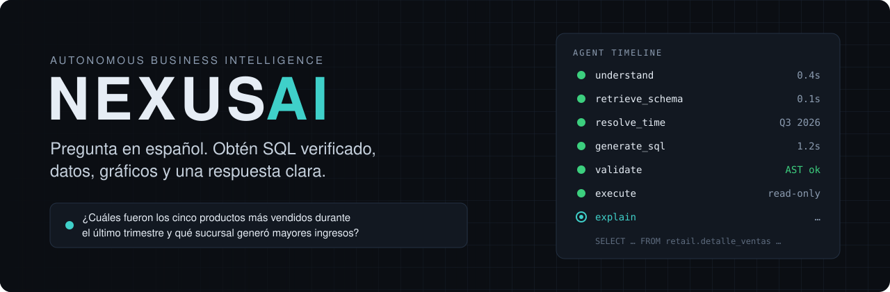
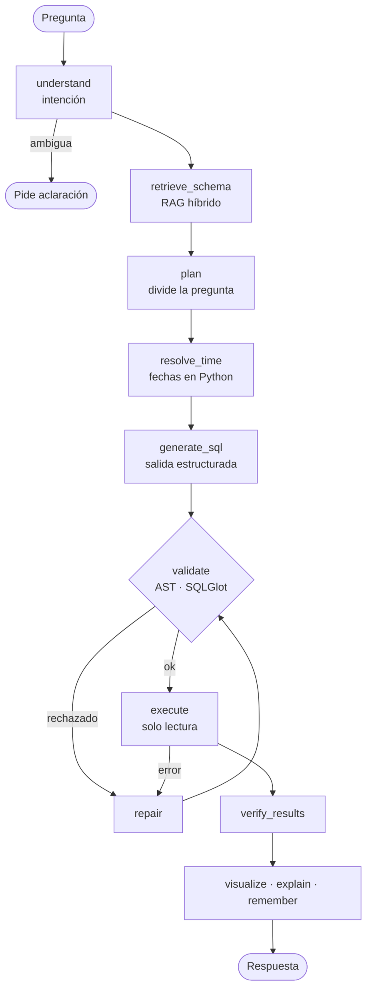
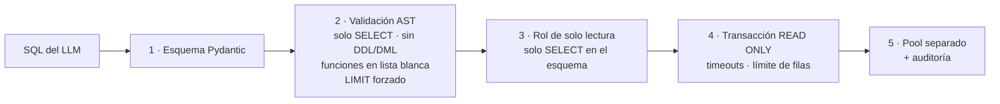
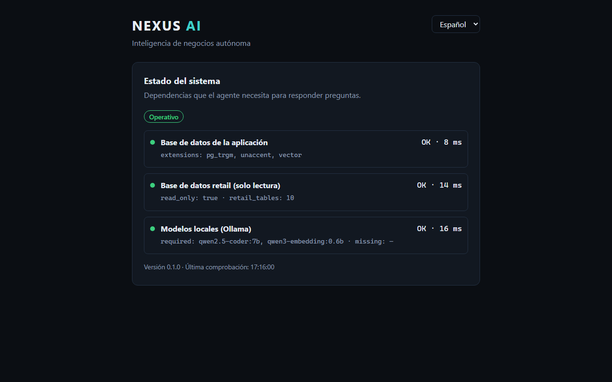
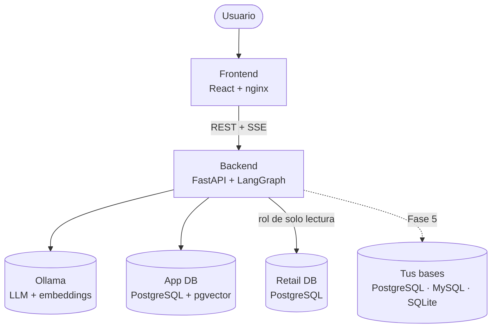

<p align="center">
  
</p>

<p align="center">
  <a href="https://github.com/ErickEchea/Agente-aut-nomo-Text-to-SQL/actions/workflows/ci.yml"></a>
  
  
  
  
  
</p>

<p align="center">
  <b>Español</b> · <a href="README.en.md">English</a>
</p>

---

**NEXUS AI** es un agente autónomo de *Text-to-SQL*: escribes una pregunta de negocio en español
—*"¿qué sucursal vendió más el último trimestre?"*— y el agente entiende la pregunta, encuentra las tablas
correctas, escribe el SQL, **lo valida antes de ejecutarlo**, lo corre en modo **solo lectura** y te devuelve
la tabla, un gráfico y un resumen ejecutivo cuyas cifras se comprueban contra los datos reales.

Todo corre **en tu máquina**: los modelos de lenguaje se sirven con [Ollama](https://ollama.com), sin APIs de
pago y sin que tus datos salgan de tu red.

> [!NOTE]
> **Estado del proyecto.** Se construye por fases ([hoja de ruta](#-hoja-de-ruta)). La **Fase 1 está
> completa**: infraestructura, base de datos de demostración, rol de solo lectura, observabilidad y CI. El
> agente conversacional (Fase 2) es lo siguiente. Esta página distingue siempre lo que **ya funciona** ✅ de
> lo que **está planificado** 🗓️.

## Contenido

- [Qué hace](#-qué-hace)
- [Cómo funciona](#-cómo-funciona)
- [Seguridad: por qué no puede romper tu base de datos](#-seguridad-por-qué-no-puede-romper-tu-base-de-datos)
- [Datos de demostración: un retail ecuatoriano](#-datos-de-demostración-un-retail-ecuatoriano)
- [Inicio rápido](#-inicio-rápido)
- [Arquitectura y stack](#-arquitectura-y-stack)
- [Hoja de ruta](#-hoja-de-ruta)
- [Calidad](#-calidad)
- [Estructura del repositorio](#-estructura-del-repositorio)
- [Documentación](#-documentación)

## ✨ Qué hace

Toma una pregunta compuesta como esta:

> *¿Cuáles fueron los cinco productos más vendidos durante el último trimestre y qué sucursal generó mayores
> ingresos?*

y la convierte en una respuesta verificable. Esta es la respuesta correcta sobre los datos de demostración
(calculada con el rol de solo lectura; es la meta que el agente debe alcanzar de punta a punta):

| # | Producto más vendido (Q3 2026, unidades) | Unidades |
|---|---|---:|
| 1 | Agua mineral 1.5 L | 4 768 |
| 2 | Pollo entero por kg Mr. Pollo | 2 707 |
| 3 | Leche entera 1 L Toni | 2 555 |
| 4 | Leche entera 1 L Parmalat | 2 098 |
| 5 | Aceite vegetal 1 L La Favorita | 1 834 |

**Sucursal con mayores ingresos:** Samborondón — **USD 299 672,19** (ingresos netos: sin IVA, sin ventas
anuladas ni líneas devueltas, según el [glosario de negocio](data/glossary.yaml)).

Lo que hace a NEXUS distinto de "pedirle SQL a un chatbot":

| | Capacidad | Estado |
|---|---|---|
| 🧠 | **Entiende la intención** y pide aclaración con opciones concretas cuando la pregunta es ambigua, en vez de adivinar. | 🗓️ Fase 2 |
| 📅 | **Fechas deterministas:** "último trimestre" lo calcula Python, no el modelo, y se muestra como supuesto visible. | 🗓️ Fase 2 |
| 🛡️ | **SQL validado sobre el árbol sintáctico** (SQLGlot) + rol de base de datos de solo lectura. | ✅ rol · 🗓️ validador |
| 🔁 | **Auto-reparación:** si una consulta falla, el agente lee el error de PostgreSQL y corrige (máx. 3 intentos, con diff visible). | 🗓️ Fase 2 |
| 🔎 | **RAG híbrido del esquema** (pgvector + búsqueda por palabras clave) usando comentarios de tablas, glosario y ejemplos verificados. | 🗓️ Fase 3 |
| 👁️ | **Razonamiento en vivo:** cada paso del agente se transmite por SSE a una línea de tiempo animada. | 🗓️ Fase 4 |
| 📊 | **Tabla, gráfico (ECharts), SQL, explicación y optimización** en pestañas; dashboards con resultados fijados. | 🗓️ Fases 4–5 |
| ✅ | **Resúmenes sin cifras inventadas:** cada número del resumen se comprueba contra los resultados. | 🗓️ Fase 3 |
| 🔌 | **Multi-base de datos:** PostgreSQL, MySQL y SQLite con credenciales cifradas. | 🗓️ Fase 5 |
| 📈 | **Benchmark propio** de 120+ preguntas que mide la precisión y elige el modelo por defecto con datos. | 🗓️ Fase 6 |

## 🧭 Cómo funciona

El agente es un grafo de [LangGraph](https://langchain-ai.github.io/langgraph/) con un nodo por responsabilidad.
Cada nodo es una función pequeña y testeable, y emite eventos de inicio, fin, duración y tokens.



La pregunta de referencia tiene **dos partes con granularidad distinta** (unidades por producto vs. ingresos por
sucursal), así que el nodo `plan` la divide en dos consultas en lugar de forzar una sola. El detalle de cada
nodo, el estado compartido y el protocolo de streaming están en
[`docs/ARCHITECTURE.md`](docs/ARCHITECTURE.md#5-agent-graph-langgraph).

## 🛡️ Seguridad: por qué no puede romper tu base de datos

El SQL que escribe un modelo de lenguaje **nunca se ejecuta sin pasar varias capas independientes**, y el
diseño exige que **cada capa baste por sí sola** ([ADR-0005](docs/adr/0005-sql-safety-defense-in-depth.md)):



**Ya verificado (Fase 1) ✅** — con tests de integración contra PostgreSQL real, el rol del agente `nexus_reader`:

- no puede hacer `INSERT`, `UPDATE`, `DELETE`, `TRUNCATE`, `DROP`, `ALTER`, `CREATE` ni `COPY … TO PROGRAM`;
- **sigue sin poder escribir aunque desactive** `default_transaction_read_only` en su sesión;
- no puede ejecutar `pg_sleep`, `set_config`, `pg_terminate_backend`, `pg_read_file` ni `lo_import`;
- no puede leer los metadatos internos ni conectarse a otras bases del servidor;
- tiene `statement_timeout` de 15 s y `lock_timeout` de 2 s.

Además, el endpoint de salud del backend **se pone en rojo** si alguna vez se configura con un rol que sí puede
escribir. La suite de 40+ ataques (inyección de prompt, CTEs que modifican datos, trucos con comentarios…) llega
en la Fase 2.

## 🇪🇨 Datos de demostración: un retail ecuatoriano

Para que las preguntas tengan respuestas interesantes, el proyecto incluye una cadena de retail ficticia con
**dos años de operación en dólares** (nov-2024 → oct-2026), generada por un script **determinista**: la misma
semilla produce exactamente los mismos datos en Windows y en Linux.

| Tabla | Filas | Tabla | Filas |
|---|---:|---|---:|
| `detalle_ventas` | 499 485 | `inventario` | 228 679 |
| `ventas` | 196 091 | `clientes` | 25 000 |
| `devoluciones` | 7 733 | `productos` | 404 |
| `empleados` | 349 | `sucursales` | 24 |

**Realismo local:** 24 sucursales en 16 provincias (Sierra, Costa, Amazonía y Galápagos), marcas que se venden en
Ecuador, cédulas con dígito verificador válido, IVA del 15 % y alimentos básicos con tarifa 0 %.

**Calendario comercial ecuatoriano:** Carnaval (calculado desde la Pascua), décimo tercer sueldo en diciembre y
décimo cuarto por región, temporada escolar Costa (abril) vs. Sierra (septiembre), Black Friday, Día de la Madre,
Día del Niño y la camiseta de la Selección durante el Mundial 2026.

**Anomalías plantadas** para que el agente las descubra: un televisor agotado en una sucursal de Quito, un lote
de licuadoras con 25 % de devoluciones, un cierre por remodelación, la apertura de una sucursal nueva, un pedido
corporativo atípico, tickets anulados y un índice que falta a propósito.

Cada tabla y columna tiene un `COMMENT ON` en español, porque esos comentarios son la materia prima del RAG.
Diseño completo en [ADR-0017](docs/adr/0017-retail-demo-dataset.md).

## 🚀 Inicio rápido

**Requisitos:** Docker Desktop (o Docker Engine + Compose v2), `make`, `openssl` y ~12 GB libres para imágenes y
modelos. Con GPU NVIDIA se usa automáticamente; sin GPU funciona en modo CPU con un modelo más pequeño.

```bash
git clone https://github.com/ErickEchea/Agente-aut-nomo-Text-to-SQL.git
cd Agente-aut-nomo-Text-to-SQL
make up
```

`make up` crea `.env` con contraseñas aleatorias, detecta si hay GPU, construye las imágenes, carga los datos de
demostración, descarga los modelos (≈5 GB la primera vez) y **espera a que todos los servicios estén sanos**.
En la máquina de referencia tarda menos de 4 minutos.

| Qué | Dónde |
|---|---|
| Aplicación web | http://localhost:8080 |
| API (documentación interactiva en modo desarrollo) | http://localhost:8000/api/docs |
| Estado de dependencias | http://localhost:8080/api/health/ready |
| PostgreSQL de la app / de demostración | `localhost:55432` / `localhost:55433` |

<p align="center">
  
  <br><sub>Fase 1: página de estado con comprobaciones en vivo (la interfaz completa llega en la Fase 4).</sub>
</p>

<details>
<summary><b>Windows</b></summary>

Ejecuta los comandos desde **Git Bash**. Instala `make` con `winget install ezwinports.make` y abre una terminal
nueva. Docker Desktop debe usar el backend WSL2 para acceder a la GPU.
</details>

<details>
<summary><b>Comandos útiles</b></summary>

```bash
make help              # lista todos los comandos
make ps                # estado y salud de los servicios
make logs s=backend    # logs de un servicio
make reseed            # regenera los datos de demostración
make check             # lint + tipos + tests unitarios
make test-integration  # tests contra PostgreSQL real (Testcontainers)
make e2e               # tests end-to-end con Playwright (stack levantado)
make down              # detiene el stack (conserva los datos)
make clean             # detiene y BORRA volúmenes y modelos
```
</details>

## 🏗️ Arquitectura y stack



La base de la aplicación y la de datos viven en **contenedores separados**: el agente consulta la base retail
exactamente igual que consultaría una base externa tuya, sin ningún camino hacia las tablas internas.

| Capa | Tecnología |
|---|---|
| Frontend | React 19, TypeScript estricto, Vite 8, TanStack Query, i18next (es/en) · *Fase 4:* Tailwind, shadcn/ui, Framer Motion, ECharts |
| Backend | Python 3.13, FastAPI, Pydantic v2, SQLAlchemy 2 (async), structlog |
| Agente | LangGraph, SQLGlot, interfaz `LLMProvider` intercambiable |
| Modelos | Ollama — candidatos `qwen2.5-coder:7b`, `qwen3:8b`, `gemma4:e4b-it-qat`; embeddings `qwen3-embedding:0.6b` ([ADR-0003](docs/adr/0003-llm-provider-and-model-selection.md)) |
| Datos | PostgreSQL 18, pgvector |
| Infraestructura | Docker Compose, Makefile, GitHub Actions |
| Calidad | pytest, Testcontainers, Hypothesis, Vitest, Playwright, ruff, mypy estricto, ESLint |

Cada decisión importante está documentada como un ADR, con su contexto, las alternativas y las consecuencias.

## 🗺️ Hoja de ruta

| Fase | Contenido | Estado |
|---|---|---|
| 0 | Plan, arquitectura, 17 ADRs | ✅ |
| 1 | Docker Compose, base de datos de demostración, rol de solo lectura, observabilidad, CI | ✅ |
| 2 | Núcleo del agente: generación, validación AST, ejecución, reparación, SSE, autenticación, suite de 40+ ataques | 🔜 siguiente |
| 3 | RAG del esquema, glosario, ejemplos verificados, memoria de corto y largo plazo | 🗓️ |
| 4 | Interfaz completa: sistema de diseño, timeline del agente en vivo, dashboards, paleta de comandos | 🗓️ |
| 5 | Explicación cláusula por cláusula, optimización con `EXPLAIN`, multi-base de datos | 🗓️ |
| 6 | Benchmark de 120+ preguntas y selección del modelo por defecto | 🗓️ |
| 7 | Endurecimiento, documentación final y demo animada | 🗓️ |

Criterios de cierre de cada fase en [`docs/ROADMAP.md`](docs/ROADMAP.md) y bitácora en [`PROGRESS.md`](PROGRESS.md).

## 🧪 Calidad

Una fase solo se cierra si **todo** está en verde: tests, lint, tipos y `docker compose` sano.

| Área | Estado actual |
|---|---|
| Backend | 56 tests unitarios + 43 de integración con PostgreSQL real · cobertura 97 % · ruff + mypy `--strict` limpios · warnings tratados como errores |
| Frontend | Vitest + 8 tests end-to-end con Playwright (escritorio y móvil, modo claro y oscuro) · ESLint estricto con tipos · `tsc` estricto |
| CI | GitHub Actions: lint, tipos, tests unitarios e integración, build de imágenes Docker |
| Datos | Checksum determinista verificado en Windows y Linux · tests de estacionalidad, integridad referencial y anomalías |

## 📁 Estructura del repositorio

```
├── backend/     API FastAPI + agente (paquete `nexus`), tests, Dockerfile
├── frontend/    Aplicación React, tests unitarios y end-to-end, nginx
├── data/        Esquema retail (DDL comentado) y glosario de negocio
├── infra/       Scripts de inicialización de PostgreSQL (roles y permisos)
├── bench/       Benchmark de precisión (Fase 6)
├── docs/        Arquitectura, ADRs, hoja de ruta, capturas
├── scripts/     Generación de secretos y detección de GPU
├── docker-compose.yml · docker-compose.gpu.yml · Makefile
```

## 📚 Documentación

- [Arquitectura](docs/ARCHITECTURE.md): diagramas de contexto, contenedores, grafo del agente, seguridad, RAG y modelo de datos.
- [Decisiones de arquitectura (ADRs)](docs/adr/README.md): 17 decisiones con alternativas y consecuencias.
- [Hoja de ruta](docs/ROADMAP.md) y [bitácora de progreso](PROGRESS.md).
- [Guía para contribuir con agentes de IA](CLAUDE.md): convenciones, comandos y reglas del proyecto.

---

<p align="center"><sub>Hecho en Ecuador 🇪🇨 · Los datos de demostración son sintéticos; cualquier parecido con personas reales es coincidencia.</sub></p>
