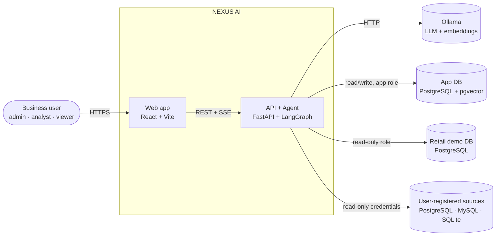
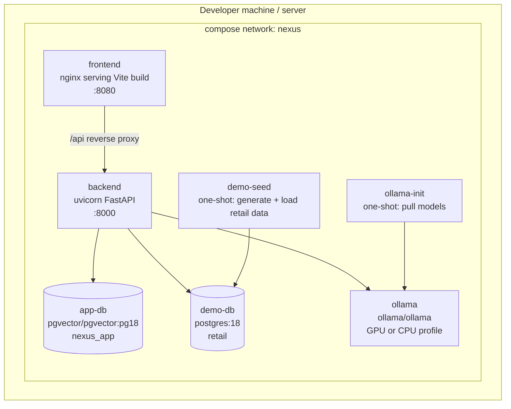
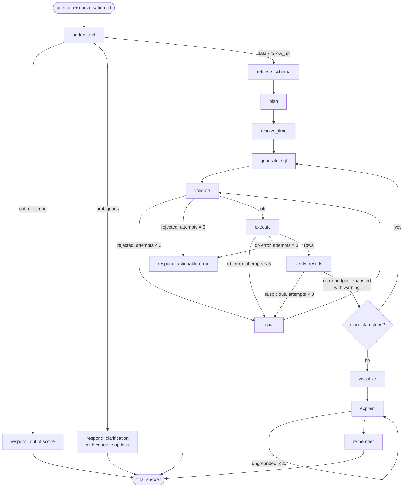
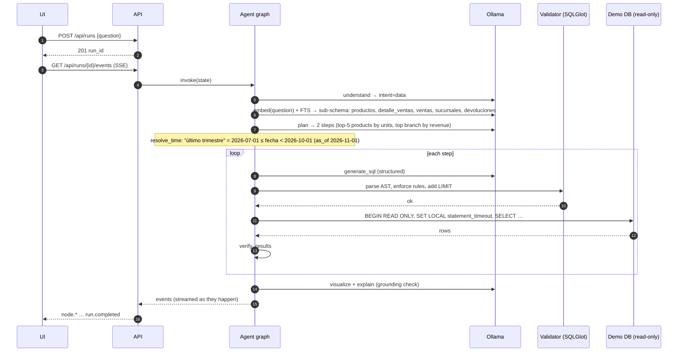
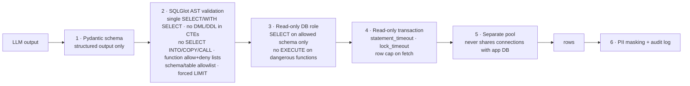
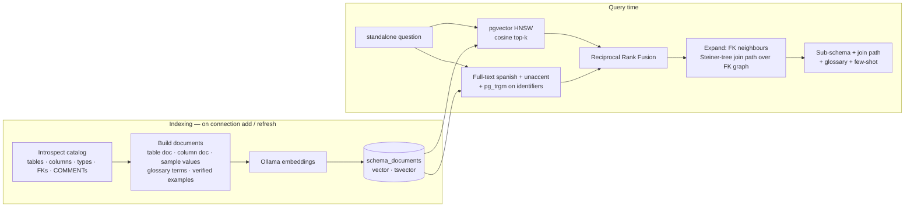
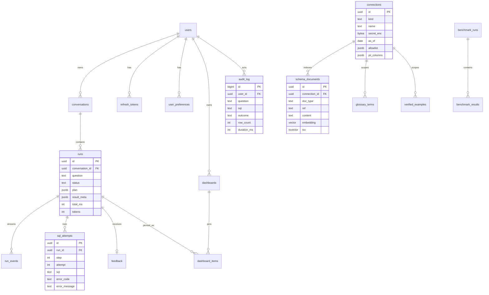

# NEXUS AI — Architecture

> Status: Phase 0 (design). Every decision referenced here has an ADR in [`docs/adr/`](adr/).
> Diagrams are Mermaid; GitHub renders them natively.

## 1. Goals and non-goals

**Goals**
- Answer natural-language business questions (Spanish first, English supported) over relational data with
  verifiable SQL, results, charts and an executive summary.
- Run fully local: no paid APIs. LLM and embeddings are served by Ollama.
- Never execute unsafe SQL. Safety is layered so that **each layer is sufficient on its own**.
- Make the agent's reasoning observable: every graph node streams its lifecycle to the UI over SSE.
- Measure quality with a reproducible benchmark (execution accuracy) that also picks the default model.

**Non-goals (v1)**
- Write access to target databases (the product is strictly read-only).
- Horizontal scaling of the API (single replica; see ADR-0011 for the rate-limit implication).
- Fine-tuning models.

## 2. System context



## 3. Containers (Docker Compose)



- Host ports avoid the defaults already in use on the dev machine (5432, 11434): app-db `55432`,
  demo-db `55433`, API `8000`, web `8080`. Ollama is **not** published to the host by default.
- Healthchecks: `pg_isready` for both databases, `/api/health/ready` for the backend (checks DBs + Ollama + models
  present), HTTP 200 for the frontend. `depends_on: condition: service_healthy|service_completed_successfully`.
- GPU is an override file (`docker-compose.gpu.yml`) selected by `make up` when `nvidia-smi` is available.
  The CPU profile swaps the default model for a smaller one (ADR-0003).
- The demo DB lives in its **own container** so the agent treats it exactly like any external source:
  separate credentials, separate pool, no network path to app tables (ADR-0006).

## 4. Backend module map

```
backend/src/nexus/
├── api/            FastAPI routers, dependencies, SSE transport, error mapping
├── agent/          LangGraph graph, typed state, one module per node, prompt templates
│   └── temporal/   deterministic relative-date resolver (es/en)
├── llm/            LLMProvider protocol + Ollama implementation, structured-output helper
├── rag/            schema introspection, document builder, embeddings, hybrid retriever, join-path finder
├── sql/            SQLGlot validator, dialect handling, executor (per-engine read-only), EXPLAIN analyzer
├── security/       JWT, password hashing, RBAC, rate limiting, credential encryption, PII masking, audit
├── memory/         short-term (conversation) and long-term (preferences, verified examples, corrections)
├── connections/    connection registry, engine pools per source, test + index workflows
├── observability/  structlog config, request_id middleware, per-node trace spans
├── db/             SQLAlchemy models for the app DB + Alembic migrations
└── config.py       pydantic-settings, single source of configuration
```

Dependency rule: `api → agent → (llm, rag, sql, memory) → db`. `security` and `observability` are
cross-cutting and may be imported anywhere; nothing imports `api`.

## 5. Agent graph (LangGraph)



### Node contracts

| Node | Input (from state) | Output (to state) | LLM? |
|---|---|---|---|
| `understand` | question, short-term memory | `intent ∈ {data, follow_up, ambiguous, out_of_scope}`, rewritten standalone question, clarification options | yes (structured) |
| `retrieve_schema` | standalone question | ranked sub-schema (tables, columns, comments, sample values), join path, glossary hits, verified few-shot examples | embeddings only |
| `plan` | question, sub-schema | `steps[]` (1..n) and strategy `single_cte | multi_query` | yes (structured) |
| `resolve_time` | question, connection `as_of` date | concrete `[start, end)` ranges + human-readable assumptions | **no** (pure Python) |
| `generate_sql` | step, sub-schema, time ranges, examples, glossary | `SqlCandidate{sql, dialect, tables_used, assumptions, rationale}` | yes (structured) |
| `validate` | candidate, allowlists | normalized SQL with enforced `LIMIT`, or `ValidationError(code, detail)` | no |
| `execute` | validated SQL, connection | rows, columns, row count, duration, or `DbError(sqlstate, message)` | no |
| `repair` | previous SQL, error, sub-schema | new candidate; attempt appended to `attempts[]` (diffed in UI) | yes (structured) |
| `verify_results` | rows, step, time ranges | `ok` or recoverable issue (empty set, unexpected NULLs, shape mismatch) | rules + yes |
| `visualize` | columns, rows (sample), question | ECharts option validated against a JSON schema | rules + yes |
| `explain` | results, assumptions | executive summary whose every number is grounded in the result set | yes (structured) |
| `remember` | full run | persisted run, conversation turn, frequency stats | no |

### State (abridged)

```python
class AgentState(TypedDict):
    run_id: UUID; user_id: UUID; connection_id: UUID; conversation_id: UUID
    question: str; standalone_question: str; locale: Literal["es", "en"]
    intent: Intent; clarification: Clarification | None
    schema_context: SchemaContext; plan: Plan; time_ranges: list[ResolvedRange]
    current_step: int; step_results: list[StepResult]
    attempts: Annotated[list[SqlAttempt], operator.add]   # every try, for the diff view
    chart: ChartSpec | None; summary: Summary | None
    assumptions: Annotated[list[Assumption], operator.add]
    usage: Annotated[list[TokenUsage], operator.add]
```

### Streaming protocol

`POST /api/runs` → `201 {run_id}`. `GET /api/runs/{run_id}/events` → `text/event-stream`.
Events are persisted (`run_events`) before being sent, so a reconnect with `Last-Event-ID` replays them.

```
event: node.started   data: {"node":"generate_sql","step":1,"attempt":1,"ts":"…"}
event: node.token     data: {"node":"explain","delta":"Las ventas…"}           (optional, explain only)
event: node.completed data: {"node":"generate_sql","duration_ms":812,
                             "tokens":{"prompt":1834,"completion":121},"output":{…summarized…}}
event: node.failed    data: {"node":"execute","error":{"sqlstate":"42703","message":"…"}}
event: run.completed  data: {"run_id":"…","status":"answered|clarification|refused|failed"}
```

The frontend consumes the stream with `fetch` + `ReadableStream` (not `EventSource`, which cannot send the
`Authorization` header), so auth stays header-based.

## 6. Request sequence (reference question)

> «¿Cuáles fueron los cinco productos más vendidos durante el último trimestre y qué sucursal generó mayores ingresos?»



## 7. SQL safety — defense in depth



- Layers 2 and 3 are each tested to stand alone: the attack suite runs once **with validation disabled
  against the read-only role** and once **with validation enabled against a privileged role**; both must block
  every destructive case (ADR-0005).
- Prompt-injection posture: user questions and database values are placed in clearly delimited data blocks,
  never concatenated into instructions; sample values are truncated and control characters stripped; the LLM has
  no tools — its only power is to propose SQL, which then goes through layers 2–5.

## 8. Retrieval (schema RAG)



Retrieval quality is measured independently (recall@k of gold tables from the benchmark's SQL), which is also
how the embedding model is chosen (ADR-0007).

## 9. Data model (app DB, abridged)



## 10. Retail demo DB

Spanish identifiers (by spec): `regiones`, `sucursales`, `categorias`, `productos`, `clientes`, `empleados`,
`ventas`, `detalle_ventas` (~500k rows), `inventario`, `devoluciones`. Every table and column has `COMMENT ON`.
Ecuadorian context, amounts in **USD** (IVA 15 %). Data range **2024-11-01 → 2026-10-31**, generated by a seeded
script with weekly and annual seasonality (Navidad, Black Friday, Día de la Madre, décimo tercer/cuarto sueldo,
regional back-to-school calendars Sierra vs. Costa), a growth trend, and planted anomalies (stock-out, returns
spike, temporary closure, new branch, outlier order) — see ADR-0017. The demo connection has `as_of = 2026-11-01`,
so relative dates resolve deterministically regardless of the wall clock (ADR-0008).

## 11. Frontend

React 19 + TypeScript strict + Vite, Tailwind v4 with design tokens as CSS variables, shadcn/ui primitives,
Motion (Framer Motion) for transitions, TanStack Query (server state), TanStack Table + Virtual (results grid),
ECharts 6 with a theme generated from the same tokens, Shiki for SQL highlighting, i18next (es default, en).
Routes: `/login`, `/` (workspace), `/dashboards`, `/history`, `/connections`, `/benchmark`, `/audit` (admin),
`/settings`. Detailed in `docs/DESIGN.md` (Phase 4).

## 12. Observability

- `structlog` JSON logs; `request_id` (from `X-Request-ID` or generated) bound in a contextvar and echoed in the response.
- Each graph node emits a span (`run_id`, `node`, `step`, `attempt`, duration, tokens, outcome) to the log
  stream **and** to `run_events`, which the UI and the audit page read. Optional OTLP exporter is out of scope for v1.
